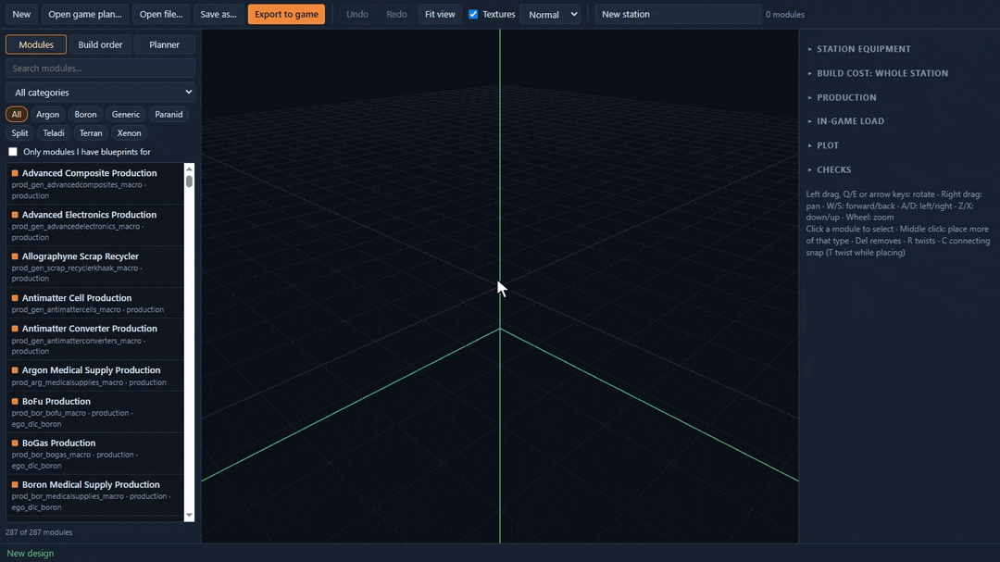
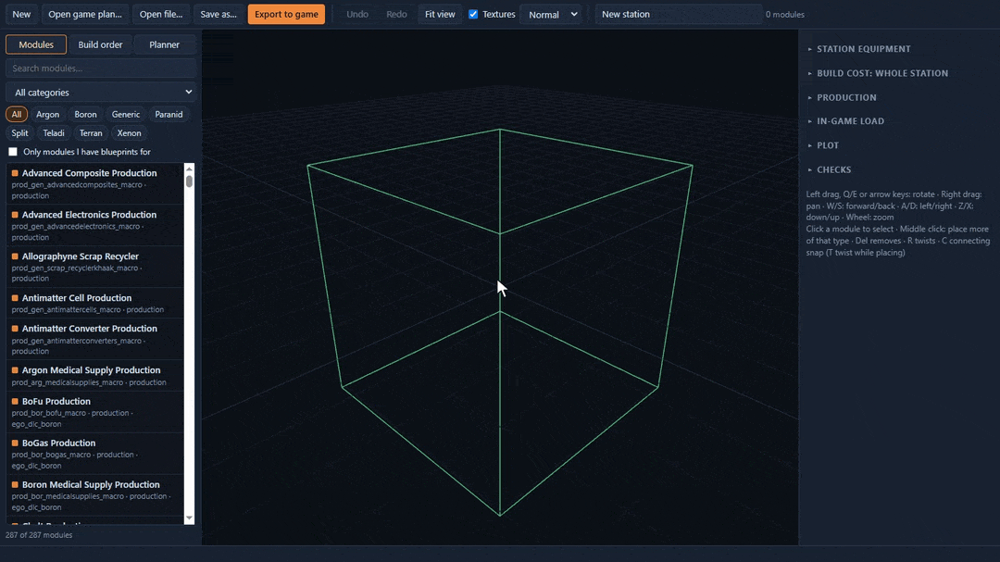
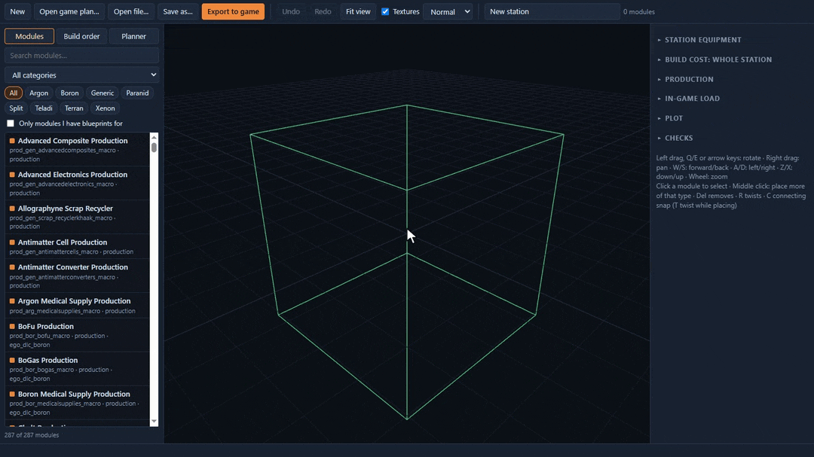
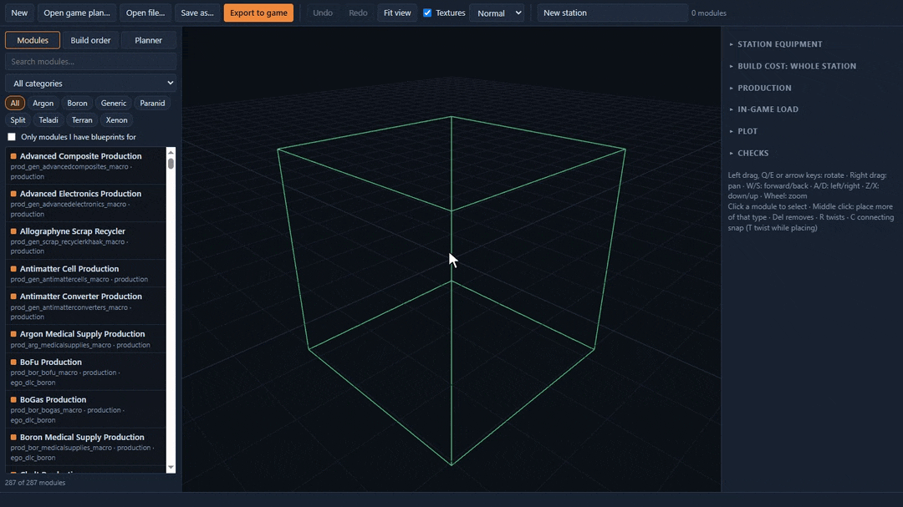

# X4 Station Designer

Design station construction plans for **X4: Foundations** outside the game, then import them in game like any other plan.

`x4sd.exe` is one Windows program: a 3D station builder, a command line and an MCP server for AI agents. It reads the module catalogue, models and textures straight from your game install, including DLCs and enabled mods, so what you build uses the real modules and snap points.



## Features
- **3D builder with the game's own models.** Pick a module from the palette (ordered like the in-game build menu, filtered by race), hover a free snap to preview it, click to attach. Twist, move, re-attach or detach modules, with undo for everything.
- **Production planner.** Name the wares you want to make and it works out the whole chain: production, habitats with their food and medicine, storage, docks. *Place all* attaches the modules at free snaps with no overlaps and adds connection structures where needed.
- **Optimize a station.** Fill a station's shortfalls and re-lay it out in layers: habitats inside, modules that carry turrets and shields around them, docks and bays outermost with clear approaches. Optionally rebuild the connection structures, and use fewer of them.
- **Station readouts.** Production and use per hour, workforce, storage, build cost per build method, and an in-game load estimate (modules, connection structures, turrets, docks, size).
- **Checks the game doesn't do.** Overlapping modules (on the collision meshes), modules blocking a pier's approach or a bay's exit, modules outside the plot, misaligned snaps, missing DLCs.
- **Build order.** See and change the order the game builds modules in, with build stages and a timeline.
- **Equipment.** Turrets and shields per module group, or for the whole station at once.
- **Blueprint limit.** Optionally read a save and offer only the modules you have blueprints for.
- **AI agents.** An MCP server with tools for every edit, the planner, the checks and the export. While the builder is open, an agent edits the design you're looking at, live.

### Production planner
Hull Parts as the target ware; *Place all* builds the station around it.


### Optimize
A 332-module Terran shipyard, optimized with *Rebuild connection structures* and *Fewer connection structures*: its shortfalls covered, re-laid out in layers, and down from 137 connection structures to 7.



### Agents, live in the builder
An agent connected through MCP builds a station while you watch. You can drag, twist or undo alongside it.



### Your saved plans
Open a plan you saved in game, check its production, cost and load, and step through its build order.



## Getting started
**You need:** Windows 10 or 11 (the builder needs the WebView2 runtime, which comes with Windows 11 and current Windows 10), and X4: Foundations installed. Tested with game version 9.00.

1. Download `x4sd.exe` from the [latest release](https://github.com/Thiago-Dantas/x4-station-designer/releases/latest) and put it anywhere. There is nothing to install. The exe isn't signed, so Windows SmartScreen may warn the first time you run it.
2. Double-click it. It finds the game through Steam and your player profile under `Documents\Egosoft\X4\<id>`. If it doesn't, start it from a terminal with `--game-dir "<X4 folder>"` and/or `--profile-dir "<profile folder>"`.
3. Build a station, or open one of yours with *Open game plan…*.
4. Click **Export to game**. This writes the plan into your profile's `constructionplan` folder.
5. In game, open the station build menu and click **Import**. The plan appears with your other plans; the game doesn't need a restart.

Exporting a plan with the same id as one you have replaces it in game, after the game asks. If you renamed it, it is exported as a new plan instead.

## For AI agents (MCP)
`x4sd mcp` is an MCP server over stdio. With Claude Code:
```
claude mcp add x4sd -- "C:\path\to\x4sd.exe" mcp
```
With other MCP clients, use the command `C:\path\to\x4sd.exe` with the argument `mcp`.

The server tells the agent how to work with it. A request like "a staffed station with 100 solar panels" becomes `list_wares`, `auto_place` with a production plan, `validate_design` and `analyze_station`. If the builder is open, every tool acts on the design shown there; otherwise the server keeps its own design. The full tool list is in [docs/usage.md](docs/usage.md#mcp-server-for-ai-agents).

## Command line
| Command | What it does |
|---------|--------------|
| `x4sd list-modules [--race R] [--class C] [text]` | Buildable station modules, including DLCs and enabled mods |
| `x4sd show <file>` | The plans in a plan file: modules, DLCs needed, plot size, in-game load |
| `x4sd validate <file>` | The builder's checks on a plan file; exit code 1 if there are problems |
| `x4sd export <file> --plan P` | Put a plan into the game's import folder |

Details and every builder control are in [docs/usage.md](docs/usage.md).

## Status
The builder, planner, CLI and MCP server work and are tested against the game data. Some things are not yet confirmed in game:
- that an auto-placed or optimized station builds, and that ships reach its docks;
- that the game follows a changed build order;
- that equipment set here is built;
- that the in-game load numbers track frame rate. They are players' rules of thumb, not measurements.

Reports from players are welcome.

## Building from source
Rust (stable, MSVC), Node.js and the Windows SDK. Build the UI first, then the exe:
```powershell
npm --prefix ui install
npm --prefix ui run build
cargo build -p x4sd --release   # target\release\x4sd.exe
```
More in [docs/dev-setup.md](docs/dev-setup.md). How X4 stores construction plans, and what we found out about them, is in [docs/x4-construction-plans.md](docs/x4-construction-plans.md).

X4: Foundations is a game by Egosoft. This is a fan-made tool, not affiliated with Egosoft. It reads the game's files and never changes them.
